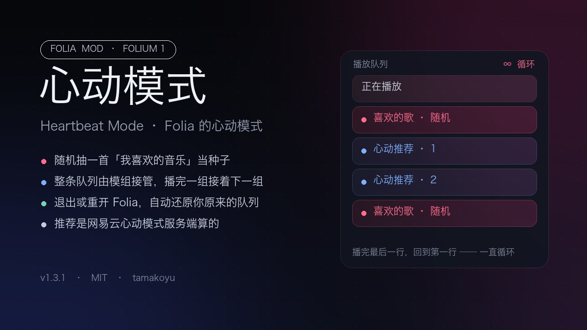

# 心动模式（Folia 模组）



把网易云的**心动模式**接进 Folia：随机抽一首「我喜欢的音乐」当种子，接两首推荐，一组接一组无限
循环；整条播放队列由模组按公开接口接管，退出、停用或重开 Folia 时自动还原你原来的队列。

不改应用、不覆盖安装，模组目录整个丢进 `mods/` 就行。

- 模组 id：`heartbeat-mode`　·　Folium 1　·　需要 Folia `>=0.7.22 <0.8.0`
- 权限：`playback.queue`、`filesystem.data`、`platform.netease.read`
- 实验接口：`platform.raw`
- 需要登录网易云

## 为什么是 2.0

1.x 往用户队列里插歌，而抽到的「喜欢」在用户歌单里本来就有副本：同一个身份在队列里出现两次，
宿主按「第一次出现」定位当前歌，下一首就顺着原歌单走了。2.0 改成**接管整条队列**（`[正在放的
那首, 喜欢, 推荐, 推荐, 喜欢, 推荐, 推荐, …]`），队列里只有模组放进去的歌，物理上不可能落回原顺序。

同时把 1.x 里所有「找宿主内部拿东西」的做法换成了 Folium 1.7 的公开成员：不再用 `folium.internals`、
不读 `localStorage`、不碰网易云 cookie，也不需要 `net.fetch`。

## 装

**方式一：拖 zip。** 在 [Releases](../../releases) 里下载 `heartbeat-mode.zip`，打开 Folia →「模组」面板 → 拖进去。

**方式二：放目录。** 把这个仓库整个放到模组目录下（目录名随便，身份以 `mod.json` 的 `id` 为准）：

```sh
git clone <本仓库地址> ~/Library/Application\ Support/Folia/mods/heartbeat-mode
# Windows: %APPDATA%\Folia\mods\heartbeat-mode
```

然后启用它。首次启用会要求确认：本模组申请了队列接管与自己的数据目录，并选用实验接口
`platform.raw`（面板会标出来），同意后才加载。

## 用

两个入口，做的是同一件事：

1. **进度条上的心动按钮**：播放器进度条右端的心跳图标。
   - 空闲：主题色，悬停「开启心动模式（网易云推荐）」。
   - 刚点下：立刻变成半透明的脉冲状态（`aria-busy`），悬停「正在准备心动模式（点击取消）」。
     这一步是同步画的，不等网络；接口慢的时候也不会再有「点了没反应」。
   - 已开启：强调色，悬停「退出心动模式（正在推荐）」。
   - 准备阶段再点一次＝取消，队列一个字都不会动；就算取消正好落在换队列之后，也会立刻换回去。
2. **命令面板**（`Ctrl`/`⌘ + K`）搜 **心动模式**：
   - **开启心动模式**：立刻进入准备状态，然后按下面的规则接队列。
   - **退出心动模式**：把整条队列换回开启前的样子（从开启时那首的后面接起），正在放的那首留着。

## 播什么

当前歌后面始终维持**两组以上**的余量（按组补齐，最多补到 6 首），每组是：

1. 一首随机的「我喜欢的音乐」——整张歌单随机抽，不按顺序、不按最近播放；
2. 两首以它为种子的推荐。

一组唱完，宿主报 `playback.songChanged`，模组看余量不足就再补一组，所以是 1 + 2 + 1 + 2 一直
循环。已经放过的历史会被丢掉，队列不会越滚越长；队列里绝不出现重复身份；整张喜欢歌单都用过
一轮之后会重开一轮。

### 推荐从哪来

模组只负责把「种子歌」交给网易云，排序和挑选都在服务端。按顺序尝试三条路：

| 顺序 | 接口 | 说明 |
| --- | --- | --- |
| 1 | `playmode_intelligence_list` | 网易云「心动模式」本身，以种子歌与「我喜欢的音乐」为参照 |
| 2 | `simi_song` | 同一颗种子的相似歌曲，思路最接近 |
| 3 | `personal_fm` | 账号口味的私人 FM，前两条都给不出新歌时兜底 |

第 1 条能不能用取决于宿主：`platform.raw` 只放行宿主自己分类表里的接口（见
`src/services/onlineMusic/netease/neteaseRaw.ts`），目前没有这条路由，所以实际走的是第 2 条。
等它加进白名单，模组不用改代码就会自动切过去（日志里只会抱怨一次「心动接口还没开放」）。

## 退出时

- 你原来的队列在开启时就被存进快照（可移植身份，跨会话），退出、停用、或重开 Folia 后都会被放回去；
  从开启时正在放的那首之后接起，正在放的那首留在队首。
- 如果你（或别的模组）整条换掉了队列，模组让路：退出但不还原，快照一起清掉。
- 播放器停在「单曲循环」时不会走队列，模组会提醒一句（那个开关不在公开接口里）。

## 测试

```sh
node test/harness.mjs
```

用假的 Folium 1.7 宿主跑发布出去的那几个文件，只有宿主那一侧是假的（`playback` / `events` /
`omni` / `experimental` / `storage` / `ui` / `registries`）。16 项断言，其中几项是冲着这次的问题去的：

- 点击之后**一行 await 都没有**时就断言按钮已经进入准备中；
- 准备中再点一次，队列必须一动不动；
- 连唱 30 首，每一步都断言队列里没有原歌单的歌，并且当前歌之后每三首都是「1 喜欢 + 2 推荐」；
- 退出、停用、崩溃重开之后原队列要一首不少地回来；
- 心动接口被宿主拒绝时只抱怨一次，然后自动改用相似歌曲；
- 队列里有重复身份就报错（1.x 的病根）。

## 已知限制

- 只在主窗口可用。
- 需要登录网易云：种子歌来自「我喜欢的音乐」。
- 「心动推荐」目前被宿主白名单挡着，走的是相似歌曲；私人 FM 是兜底，不是主路径。
- 依赖 Folium 1.7（Folia 0.7.22 起）：更老的版本上按钮不会出现，而不是按了没反应。

## 许可

MIT，见 [LICENSE](LICENSE)。